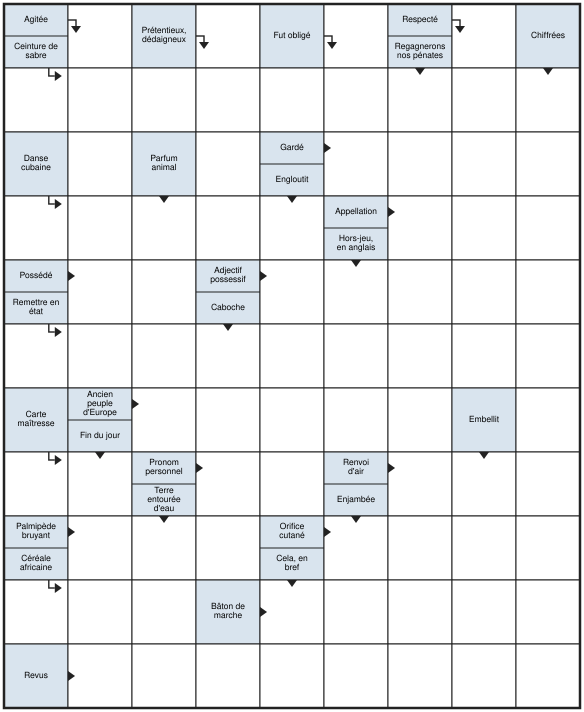
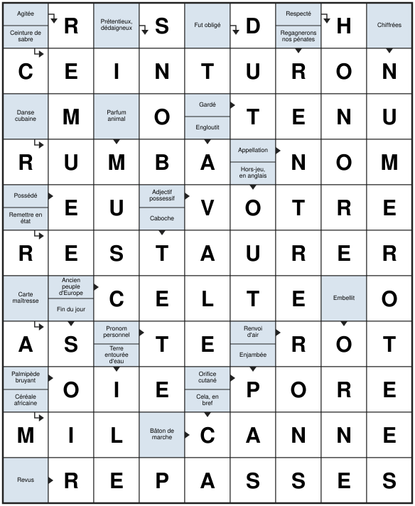

# CrossWords

**Générateur de grilles de mots croisés à la française et de mots fléchés**, en Rust, sans aucune dépendance.

Donnez une taille, obtenez une grille remplie de vrais mots français, prête à imprimer : cases noires placées à la française pour les mots croisés, cases définitions et flèches pour les mots fléchés, avec quatre niveaux de difficulté et des définitions rédigées automatiquement si vous le souhaitez.

<p align="center">
  
  &nbsp;
  
</p>
<p align="center"><em>Mots fléchés 9x11, niveau 2 : <code>crosswords --fleches --size 9x11 --niveau 2 --seed 14 --svg grille.svg --svg-solution solution.svg</code></em></p>

## Fonctionnalités

- **Mots croisés à la française** : cases noires isolées, sans symétrie imposée, rangées en chiffres romains et colonnes en chiffres arabes.
- **Mots fléchés** : cases définitions portant une ou deux définitions, flèches droites et coudées, définitions dans les cases ou numérotées sous la grille.
- **Quatre niveaux de difficulté** pour les mots fléchés : vocabulaire, densité de cases définitions et style des définitions, du synonyme direct au jeu de mots.
- **Définitions automatiques** des mots fléchés par l'API Claude, mises en cache pour resservir.
- **Dictionnaire français** téléchargé au premier lancement, avec fréquences d'usage pour écarter les mots trop rares.
- **Sorties** texte, SVG imprimable (grille vierge et solution) et [JSON documenté](docs/format-json.md).
- **Reproductible** : même graine, mêmes options, même grille.
- **Rapide** : une grille par défaut se remplit en moins d'une seconde, même en 15x15.

## Installation

Des exécutables pour Linux, macOS et Windows sont publiés avec chaque [version](https://github.com/XNinety9/CrossWords/releases). Ou, avec Rust 1.85 ou plus récent :

```sh
cargo install --git https://github.com/XNinety9/CrossWords
```

Au premier lancement, CrossWords télécharge sa liste de mots (une trentaine de secondes, une seule fois). Il lui faut pour cela la commande `curl`, présente sur Linux, macOS et Windows 10 et plus.

## Démarrage rapide

```sh
# Une grille de mots croisés 10x10
crosswords --size 10x10

# Une grille de mots fléchés 11x13 de niveau 3, à imprimer avec sa solution
crosswords --fleches --size 11x13 --niveau 3 --svg grille.svg --svg-solution solution.svg

# La même, avec les définitions rédigées automatiquement (clé ANTHROPIC_API_KEY)
crosswords --fleches --size 11x13 --niveau 3 --auto-defs --svg grille.svg --svg-solution solution.svg
```

Chaque lancement affiche la graine utilisée : la repasser avec `--seed` redonne la même grille.

## Mots croisés

```sh
crosswords --size 10x10 --seed 4
```

```
        1  2  3  4  5  6  7  8  9 10
    I   ■  D  A  T  E  ■  A  M  I  S
   II   U  ■  R  E  V  I  R  E  N  T
  III   T  E  R  R  I  N  E  S  ■  Y
   IV   ■  T  I  R  E  T  ■  S  E  L
    V   D  E  V  O  R  E  R  ■  A  I
   VI   U  S  A  I  ■  R  E  C  U  S
  VII   R  ■  I  R  O  N  I  E  ■  E
 VIII   A  G  E  ■  S  E  T  ■  T  E
   IX   ■  I  N  N  E  ■  R  U  E  ■
    X   I  N  T  E  R  V  E  N  E  Z

Horizontalement
      I. DATE - AMIS
     II. REVIRENT
    III. TERRINES
     IV. TIRET - SEL
      V. DEVORER - AI
     VI. USAI - RECUS
    VII. IRONIE
   VIII. AGE - SET - TE
     IX. INNE - RUE
      X. INTERVENEZ
Verticalement
      1. UT - DURA
      2. ETES - GIN
      3. ARRIVAIENT
      4. TERROIR - NE
      5. EVIER - OSER
      6. INTERNE
      7. ARE - REITRE
      8. MESS - CE - UN
      9. IN - EAU - TEE
     10. STYLISEE
```

Le taux de cases noires par défaut croît avec la taille (de 12 % à 20 %) ; `--blacks 0.10` le règle. On peut aussi remplir son propre gabarit : un fichier texte où `#` est une case noire, `.` une case vide et une lettre une lettre imposée.

```sh
crosswords --template gabarit.txt
```

**Règles des gabarits générés.** Cases blanches d'un seul tenant, aucune case blanche hors de tout mot, noires non adjacentes (`--adjacent` pour lever cette règle), longueur des mots bornée (`--max-len`), nombre de cases « muettes » plafonné. Les noires sont placées en priorité là où elles coupent les plus longues suites de cases blanches.

## Mots fléchés

```sh
crosswords --fleches --size 11x13 --niveau 2 --svg grille.svg --svg-solution solution.svg
```

La première rangée et la première colonne alternent cases définitions et cases lettres ; d'autres cases définitions sont semées à l'intérieur pour couper les mots. Chaque mot est défini depuis la case qui le précède (flèche droite `→` ou `↓`) ou, s'il part d'un bord, depuis la case voisine par une flèche coudée (`↴` vers la droite puis le bas, `↳` vers le bas puis la droite). Une case porte au plus deux définitions, et aucune n'est inutile.

### Niveaux de difficulté

`--niveau N`, de 1 à 4 (2 par défaut), règle trois choses à la fois :

| Niveau | Vocabulaire | Cases définitions | Style des définitions |
|---|---|---|---|
| 1, facile | mots très courants (24 000) | plus nombreuses | synonyme direct : ETE « Saison chaude » |
| 2, moyen | mots courants (43 000) | référence | moins immédiat : ANSE « Petite baie » |
| 3, difficile | vocabulaire étendu (66 500), sans préférence | moins nombreuses | périphrase, culture : MISERERE « Allegri le mit en musique » |
| 4, très difficile | mots rares d'abord (96 500) | encore moins | double sens, jeu de mots : OURS « Encadré dans la presse » |

Mesuré sur cinq grilles 11x13 par niveau : le score de fréquence médian des mots passe de 34 au niveau 1 à 22 au niveau 4, et la longueur moyenne des mots de 4,4 à 5,2 lettres. `--min-score` et `--blacks` restent prioritaires sur le niveau.

### Définitions

Les définitions sont lues dans un fichier `MOT<TAB>définition`, suivi éventuellement d'une tabulation et d'un niveau de 1 à 4 (sans niveau, la définition vaut pour tous). Deux sources sont combinées :

- le **cache de définitions**, `definitions.txt` dans le dossier de cache, toujours lu ;
- un fichier passé par **`--defs`**, qui prime sur le cache et n'est jamais modifié.

Sans définition connue, la case affiche la longueur du mot entre parenthèses, et `--missing` liste les mots restant à définir.

**Rédaction automatique.** Avec `--auto-defs`, les mots sans définition pour le niveau demandé sont envoyés en un seul lot à l'API Claude, avec la clé de `ANTHROPIC_API_KEY` (et `ANTHROPIC_BASE_URL` si elle est définie) : Claude Haiku 5.5 aux niveaux 1 et 2, Claude Opus 5.5 aux niveaux 3 et 4, où les jeux de mots demandent un modèle plus fort.

- Le modèle identifie d'abord chaque mot (graphie accentuée, nature, personne, temps), puis rédige une définition de même forme, au style du niveau, en s'inspirant des définitions de ce niveau déjà connues.
- Chaque définition est contrôlée : 30 caractères au plus, aucun mot de plus de 11 lettres (pour tenir dans une case), pas le mot à trouver. Les refusées sont redemandées une fois, avec la raison du refus.
- Les définitions acceptées sont ajoutées au cache, sous un commentaire `# Rédigées par <modèle>, niveau N : à relire`, et ne sont plus jamais redemandées.
- Coût pour une grille 11x13 (une quarantaine de mots) : moins d'un centime avec Haiku, une dizaine de centimes avec Opus. Les requêtes Opus activent le repli côté serveur en cas de refus des filtres de sécurité.
- La clé est transmise à `curl` par l'entrée standard, jamais en argument de ligne de commande.

Relisez avant d'imprimer : environ une définition sur vingt mérite d'être retouchée, directement dans le cache.

### Grilles à numéros

Avec `--numeros`, les cases définitions ne portent qu'un numéro et leurs flèches, et les définitions numérotées sont listées sous la grille, sur deux colonnes : pratique pour des définitions plus longues qu'une case.

```sh
crosswords --fleches --size 11x13 --niveau 4 --numeros --auto-defs --svg grille.svg
```

## Export JSON

`--json FICHIER` écrit la grille, ses mots et ses définitions en JSON ; `--json -` l'écrit sur la sortie standard à la place du rendu texte.

```sh
crosswords --fleches --size 11x13 --niveau 3 --json grille.json
crosswords --size 10x10 --json - | jq -r '.mots[].mot'
```

Le format est décrit dans [docs/format-json.md](docs/format-json.md), avec un [schéma JSON](docs/crosswords.schema.json) pour valider les fichiers.

## Dictionnaire

Sans `--dict`, CrossWords utilise une liste française téléchargée au premier lancement puis lue depuis le cache (`~/.cache/crosswords/`, ou `$XDG_CACHE_HOME`, `%LOCALAPPDATA%` sous Windows, ou `$CROSSWORDS_CACHE`). Elle fusionne deux sources, figées par version et vérifiées par empreinte SHA-256 :

- [an-array-of-french-words](https://github.com/words/an-array-of-french-words) 2.0.0 (MIT) : 336 000 formes, flexions comprises, qui fixent les mots admis ;
- [Lexique](http://www.lexique.org) 3.83 (CC BY-SA 4.0) : fréquences d'usage dans les films et les livres, qui servent à noter les mots.

Le score d'un mot croît avec le logarithme de sa fréquence : 0 pour un mot absent de Lexique, 12 vers 0,1 occurrence par million de mots, 21 vers une par million, 41 vers cent par million. `--min-score` écarte les mots de score inférieur : 12 par défaut pour les mots croisés (66 500 mots), selon le niveau pour les mots fléchés, 0 pour garder toutes les formes (319 000 après normalisation). Les mots de meilleur score sont aussi favorisés au tirage.

On peut fournir sa propre liste avec `--dict` : un mot par ligne, avec un score entier optionnel après une tabulation (ou espace, `;`, `,`). Les accents et ligatures sont retirés à la lecture (`cœur` devient `COEUR`), les mots contenant un tiret, une apostrophe ou un chiffre sont ignorés, les doublons fusionnés. Aucun seuil n'est alors appliqué par défaut.

## Bibliothèque

CrossWords s'utilise aussi comme bibliothèque Rust :

```rust
use crosswords::{Dictionary, FlechesOptions, GenerateOptions, generate, generate_fleches, wordlist};
use std::{fs::File, io::BufReader};

let path = wordlist::french(|msg| eprintln!("{msg}"))?; // téléchargée au premier appel
let dict = Dictionary::from_reader(BufReader::new(File::open(path)?), 12)?;

let mut o = GenerateOptions::new(10, 10);
o.seed = 42;
let (grille, _stats) = generate(&dict, &o)?;
println!("{grille}\n{}", grille.word_list());

let (fleches, _) = generate_fleches(&dict, &FlechesOptions::new(9, 11).with_level(3))?;
std::fs::write("fleches.json", fleches.to_json(None, Some(42), Some(3)))?;
```

Points d'entrée :

| Fonction | Rôle |
|---|---|
| `generate`, `fill` | Mots croisés : génération complète, ou remplissage d'un gabarit. |
| `generate_fleches`, `fill_fleches` | Mots fléchés, avec rattachement des mots à leurs cases définitions. |
| `random_pattern`, `random_fleches_pattern` | Gabarits seuls. |
| `Grid::to_svg`, `Fleches::to_svg`, `Fleches::to_svg_numbered` | Rendus SVG. |
| `Solution::to_json`, `Fleches::to_json` | Export JSON. |
| `level_settings`, `FlechesOptions::with_level` | Réglages des niveaux de difficulté. |
| `wordlist::french` | Liste de mots par défaut, téléchargée et mise en cache. |
| `autodefs::generate` | Rédaction des définitions par l'API Claude. |

## Comment ça marche

Remplir une grille est un problème de satisfaction de contraintes : chaque emplacement doit recevoir un mot du dictionnaire, les mots qui se croisent partagent une lettre, et aucun mot n'est répété.

- **Index par bitsets.** Pour chaque longueur, le dictionnaire tient un bitset par couple (position, lettre). Les mots compatibles avec un motif comme `A..E.` s'obtiennent par un ET de bitsets, sans parcourir de liste.
- **Propagation de contraintes.** Chaque case garde l'ensemble des lettres encore possibles, chaque emplacement l'ensemble de ses mots candidats. Toute réduction se propage aux mots croisés, jusqu'au point fixe : une impasse se voit plusieurs coups à l'avance.
- **Recherche.** Le solveur remplit d'abord l'emplacement le plus contraint, en essayant d'abord le mot qui laisse le plus de choix aux mots croisés. Un mot réfuté est retiré de l'emplacement pour le reste de la branche.
- **Redémarrages.** Certains gabarits sont faciles, d'autres presque impossibles : plutôt que de s'acharner, CrossWords accorde un petit budget à chaque gabarit et en tire un autre en cas d'échec.
- **Déterminisme.** Le budget est compté en étapes de recherche, pas en temps : même graine, même grille, sur toute machine.

## Performances

Mesurées sur un cœur, graines 1 à 5, chargement du dictionnaire compris (environ 0,1 s) :

| Grille | Cases noires | Seuil | Réussite | Temps |
|---|---|---|---|---|
| Mots croisés 8x8 à 15x15 | défaut (12 % à 20 %) | 12 | toujours | < 0,2 s |
| Mots croisés 13x13 | 14 % | 12 | toujours | 0,3 à 1,2 s |
| Mots croisés 10x10 | 10 % | 12 | 4 sur 5 | 2 à 14 s |
| Mots croisés 10x10 | 10 % | 0 | toujours | 0,5 à 3 s |
| Mots croisés 10x10 | 8 % | 0 | toujours | 2,5 à 35 s |
| Mots croisés 13x13 | 12 % | 0 | toujours | 1 à 14 s |
| Mots croisés 15x15 | 13 % | 0 | toujours | 12 à 28 s |
| Mots fléchés 9x11 à 15x17 | selon le niveau | selon le niveau | toujours | < 2,5 s |

Pour les grilles très denses, baisser le seuil (plus de mots) ou la longueur maximale des mots (`--max-len`) aide beaucoup.

## Tests

```sh
cargo test
```

41 tests unitaires et un doctest. Les grilles produites ont aussi été vérifiées par des scripts indépendants : tous les mots appartiennent au dictionnaire, aucun doublon, aucune case orpheline, chaque mot fléché a sa case définition, et chaque export JSON respecte le schéma et les garanties de sa documentation.

## Publier une version

Mettre à jour `version` dans `Cargo.toml` et le [journal des modifications](CHANGELOG.md), puis pousser une étiquette `vX.Y.Z` : le workflow [release](.github/workflows/release.yml) vérifie la version, lance les tests, compile pour Linux, macOS et Windows, et publie la version sur GitHub avec ses notes.

## Licence

CrossWords est distribué sous licence [Apache 2.0](LICENSE) : vous pouvez le réutiliser, le modifier et le redistribuer, à condition de citer l'auteur original en conservant le fichier [NOTICE](NOTICE). Les listes de mots, téléchargées à l'exécution, ont leurs propres licences (MIT pour an-array-of-french-words, CC BY-SA 4.0 pour Lexique).
